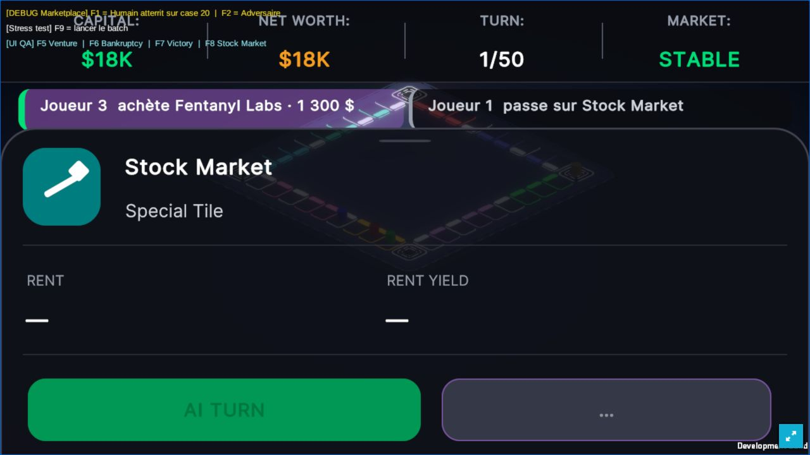
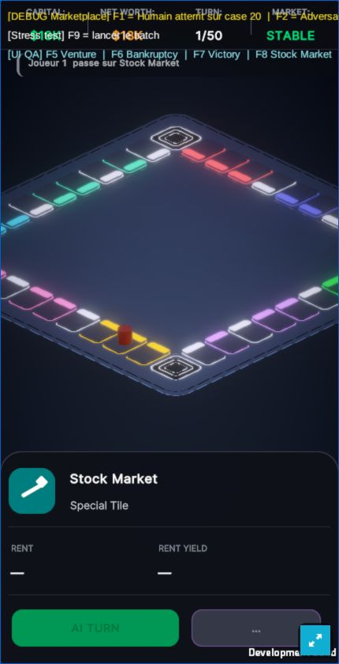

# Recette des notifications — 8 octobre 2026

Le build WebGL final a été exécuté dans le navigateur sur localhost.

- 1280×720 : achat de Fentanyl Labs par Joueur 3 et passage sur Stock Market par Joueur 1 visibles simultanément, sans ellipse sur ces phrases, au-dessus du panneau de case.
- 430×840 : passage sur Stock Market conservé pendant le début du tour suivant. Un événement de décision prime sur les événements automatiques.
- Changement portrait vers desktop effectué sans erreur navigateur. La rotation pendant deux messages actifs reste à tester.
- Logs navigateur de niveau error : liste vide.
- Build : `/tmp/polyrisk_activity_priority_webgl.log`, succès Unity et `WEBGL PLAYER BUILD PASS`.
- Régression mécanique avant le dernier ajustement de priorité : 76 assertions ; le build final confirme la compilation de l’ajustement, et le test navigateur vérifie son comportement visible.

Ces tests utilisent une partie locale avec IA. Ils ne prouvent pas encore la réception
des messages par six clients en ligne, ni la reconnexion de l’hôte.

Prochaine recette réseau : démarrage à 2 puis 6 sièges, notification identique sur chaque
client, coupure/reprise d’un invité et retour de l’hôte sur le snapshot existant.
Le démarrage actuel de l’hôte tente de publier une version initiale 0 après reconnexion ;
il doit restaurer la version serveur avant de reprendre son rôle autoritaire.
