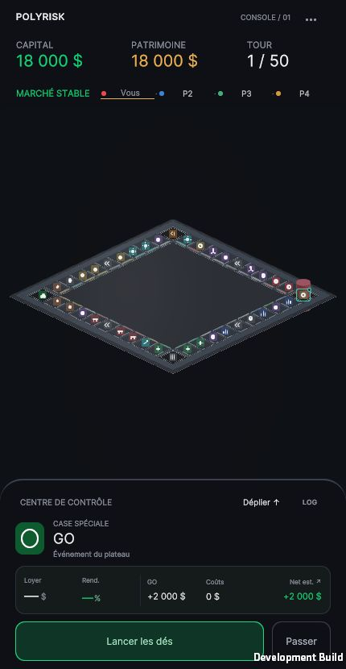
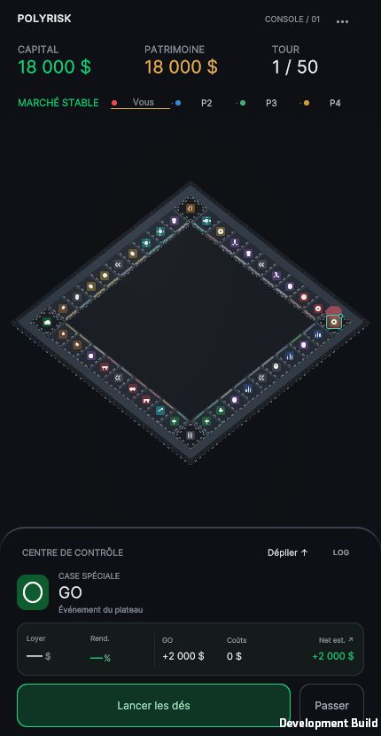
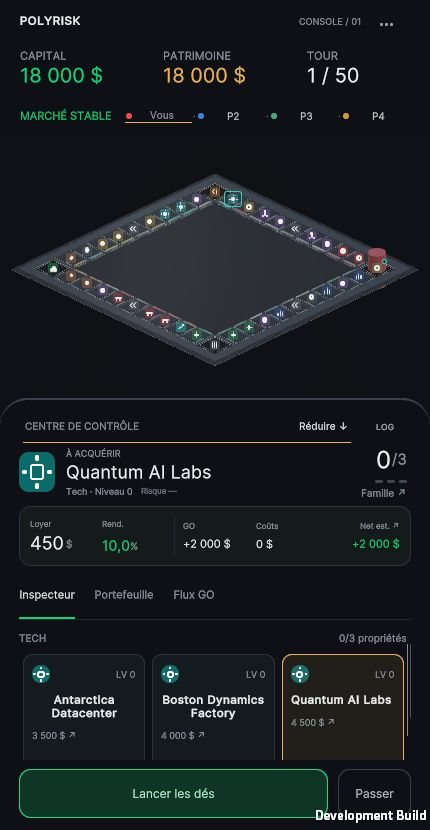
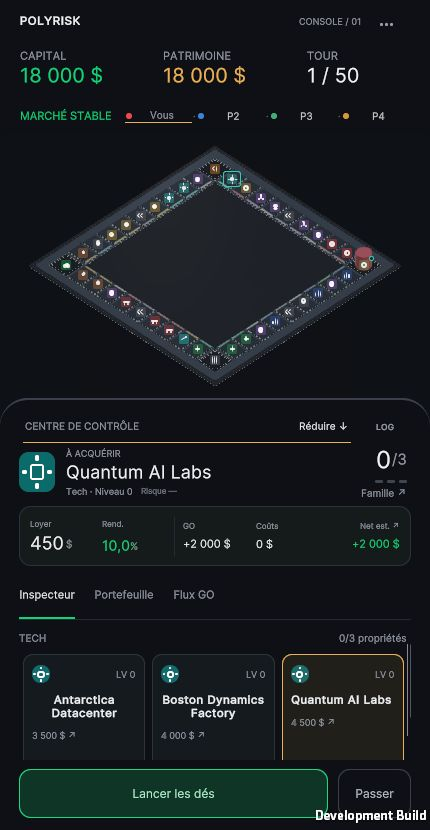
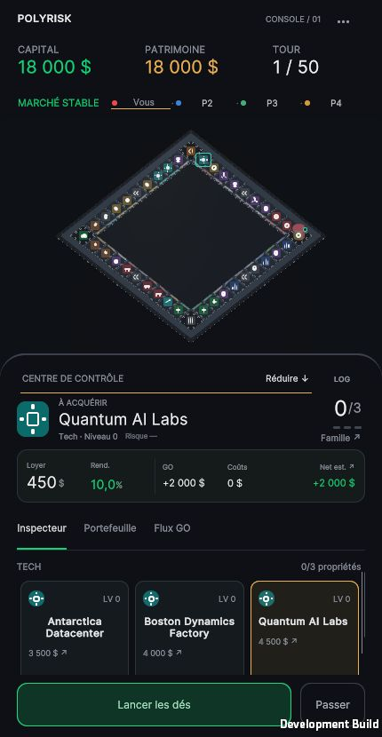

# POLYRISK — PASS 2B.1

Livraison du 19 octobre 2026. **Arrêt après comparaison ; choix de caméra en attente de validation artistique.**

Le mode Analyse est retiré, ses données économiques sont conservées dans l’inspecteur existant. Le cadrage par défaut conserve l’angle de scène A. **Recommandation : B à 40°**, sans l’appliquer comme nouveau défaut.

## Comparaison contrôlée WebGL — 430 × 830

Captures originales du canvas, sans retouche : même HUD, cockpit compact 236 px, quatre joueurs au GO, 18 000 $ chacun, sélection GO. Aucun lancer ou achat entre les trois captures. Pas d’image générée.

| A — angle actuel, 28,16° | B — 40° | C — 52° |
|---|---|---|
|  |  |  |

La cause est géométrique : à 45° d’azimut, le rapport H/L d’un carré horizontal orthographique vaut `sin(élévation)`. Le zoom ne peut pas changer ce rapport. Voir [audit complet et proposition de zoom](AUDIT.md).

| Vue | Élévation | Board L × H, px | H/L | Petit côté min., px | Épaisseur min., px | Aire min., px² | Board déployé, px |
|---|---:|---:|---:|---:|---:|---:|---:|
| A | 28.16° | 406 × 192.1 | 0.473 | 14.45 | 11.16 | 231.4 | 406.0 × 192 |
| B | 40.00° | 406 × 261.4 | 0.644 | 15.54 | 14.14 | 315.2 | 372.8 × 240 |
| C | 52.00° | 406 × 320.2 | 0.789 | 16.64 | 16.18 | 386.4 | 304.3 × 240 |

Les tailles des cases sont mesurées sur leurs empreintes de collider projetées ; l’épaisseur est la hauteur perpendiculaire minimale du parallélogramme, pas une boîte englobante. Le board est mesuré sur les sommets des quatre meshes réels. [Méthode précise](METRICS.md), [mesures brutes du build](browser-validation.json).

**A** préserve exactement la perspective antérieure et reste la plus stable entre les deux crans ; son losange demeure trop comprimé, avec seulement 11,16 px d’épaisseur minimale par case. Le cadrage optimisé conserve 12 px latéraux ; aucune marge à récupérer par un zoom global.

**B recommandée** gagne **36,1 % de hauteur** et **26,7 % d’épaisseur minimale des cases** par rapport à A, avec la même largeur et le même `orthographicSize` (20,65219). Le parcours paraît moins écrasé, les surfaces se séparent mieux, et le pion existant reste repérable au GO. En déployé, la largeur reste de 372,8 px, soit une réduction de seulement 8,2 %. Cette continuité entre observation et inspection est le meilleur compromis des trois vues testées.

**C** donne la présence la plus forte en compact, avec 320,2 px de hauteur et 16,18 px d’épaisseur minimale. Elle se rapproche d’une lecture de dessus, avec moins de hauteur visuelle du pion. En déployé, la largeur tombe à 304,3 px (−25,1 %) et l’épaisseur minimale à 12,13 px, inférieure à B déployée (12,98 px). Le gain compact demande donc un changement d’échelle plus fort lors de l’inspection. C reste une alternative visuelle soumise à ton choix, pas le défaut retenu automatiquement pour sa taille.

## Composition et espaces disponibles

HUD 134 px + cockpit compact 236 px = 370 px sur 830. La zone brute intermédiaire fait 460 px ; après marges, la zone libre est **406 × 436 px**. Le vide vertical autour du board représente 243,9 px en A, 174,6 px en B, 115,8 px en C, réparti au-dessus et en dessous. Cet espace n’est pas rempli artificiellement. La cause dominante du vide en A est l’angle de projection.

Le cockpit déployé mesure 432 px ; la zone libre devient **406 × 240 px**. Les trois vues contiennent toujours les 40 colliders après stabilisation. Le retour au compact restaure exactement le cadrage initial en B et C. Les boutons d’action restent visibles, 49 px de haut, hors du board ; l’inspecteur déployé garde son contenu défilable. Les zones de sécurité existantes sont conservées.

| A déployée | B déployée | C déployée |
|---|---|---|
|  |  |  |

## Analyse supprimée, inspection conservée

Retirés : bouton Analyse/Retour normal, légende, booléen de bascule, pourcentages et lignes de liaison, placement anticollision dédié, formateur de rendement de l’overlay, styles devenus inutiles. L’ancien outil F10 / `graphiteIsolation=1` est supprimé puisqu’il ne sert plus à masquer des badges disparus.

Conservés : 40 glyphes, marqueur propriétaire, sélection, position active, état sabotage existant ; couche en `PickingMode.Ignore`. Les méthodes de visibilité employées pendant les modales sont seulement renommées pour parler d’identités. La sélection, les autorisations et la présentation financière de l’inspecteur sont inchangées octet pour octet.

Le tap réel sur la case **31 — Quantum AI Labs** fonctionne aux trois angles : loyer **450 $**, rendement **10,0 %**, propriétaire « À acquérir », niveau 0 et famille Tech. Le risque reste « Risque — », car aucune statistique individuelle n’est modélisée par les sources actuelles. Les commandes restent celles de la phase Planning ; inspecter une case ne crée pas une autorisation d’achat.

Preuves : [A inspection](a-inspection.jpg), [B inspection](b-inspection.jpg), [C inspection](c-inspection.jpg), [menu fonctionnel après retrait d’Analyse](menu-access.jpg). [Capture PASS 2B antérieure](before-pass2b.jpg).

## Paramètres et architecture

- A : quaternion de scène inchangé, élévation 28,15999°, azimut 45°, projection orthographique.
- B : élévation 40° ; C : 52°. Même azimut 45°, roulis 0. Aperçus fixes de développement uniquement, via `?boardView=B` / `?boardView=C`.
- Fit : sommets réels des quatre meshes + huit coins de chaque collider + réserve pion/hop de 1,45 unité à chaque ancre ; cache calculé une fois. Plus d’AABB mondiale englobant une réserve dans des coins vides.
- Marge 12 unités UI, lissage existant 18/s, Reduced Motion conservé. Ni matériaux, ni dimensions des cases, ni glyphes 10 px, ni hauteurs de HUD/cockpit ne sont ajustés.
- `BoardInteractionManager` reste l’unique auteur de la caméra. Aucun angle nouveau enregistré dans la scène, aucune rotation automatique, aucun geste de zoom ajouté.

Le [zoom manuel proposé](AUDIT.md#zoom-complémentaire-proposé-non-implémenté) est limité à ×1,00–×1,60 avec boutons tactiles et restauration immédiate de la vue entière. Il reste entièrement à valider avant développement.

## Fichiers

Huit fichiers modifiés :

- `Assets/Scripts/Systems/BoardInteractionManager.cs` — fit de l’enveloppe réelle, suppression de la dépendance à la légende, variantes de développement.
- `Assets/Scripts/UI/BoardTileOverlayWidget.cs` — identités seules, suppression complète de l’analyse.
- `Assets/Scripts/UI/TopHUDWidget.cs` — renommage des références à la couche d’identités uniquement.
- `Assets/Scripts/UI/Marketplace_UIManager.cs` — même renommage des trois appels de visibilité, sans changement de comportement.
- `Assets/UI/Layouts/TopHUD.uxml` — retrait bouton/légende.
- `Assets/UI/Styles/Theme.uss` — retrait styles financiers et Analyse, conservation des identités.
- `Assets/Scripts/Debug/MobileBoardValidationProbe.cs` — mesures de projection et preuves d’inspection, développement uniquement.
- `Assets/Scripts/Editor/MobileBoardPresenceValidation.cs` — remplacement des tests Analyse par projection A/B/C, raycasts écran et vérifications de retrait.

Supprimés : `Assets/Scripts/Debug/GraphiteVisualIsolation.cs` et son `.meta`. Aucun nouvel asset runtime. Créés dans ce dossier : rapport, audit, méthode, captures réelles, inventaires SHA-256, journal, données navigateur, script de vérification de périmètre et serveur local de capture.

## Validations exécutées

Unity **2022.3.62f3**, URP **14.0.12**, IL2CPP WebGL Development.

- **612 assertions existantes PASS** : économie 143, mécanique 148, événements 17, UI 304.
- **189 contrôles de cette passe PASS** : 40 indices uniques, quatre meshes fusionnés, 40 raycasts verticaux, 120 raycasts écran aux angles A/B/C, rotation par défaut, visibilité/framing portrait/desktop compact/déployé, DPR 2 théorique, safe areas natives/CSS, paysage court et absence d’Analyse.
- **Compilation WebGL réussie**, processus terminé avec code 0. Aucun `error CS` ni `Shader error` dans le journal. [Journal complet](build.log), [résultat géométrique](geometry-and-framing.txt).
- **Navigateur réel** : canvas 430 × 830, DPR 1 ; 11 états relevés, 40 centres et 40 colliders entièrement contenus dans leur zone utile à chaque état ; inspection réelle case 31 A/B/C ; déploiement A/B/C ; restauration exacte B/C ; menu accessible. État économique identique aux trois départs et après inspection. Aucune erreur console de niveau `error` relevée lors du dernier contrôle C.
- **Périmètre PASS** : 578 fichiers des Assets/ProjectSettings inchangés face à l’inventaire de début de passe, y compris RulesEngine, ActionButtonsWidget, PawnMovement, scènes, géométrie, thème, matériaux, shaders et réseau. Routage input/raycast/permissions identique. [Détail](scope-validation.json) ; relancer `python3 Docs/Validation/BoardProjection_2026-10-19/verify_scope.py` depuis le projet.

## Limites et prochaine action

La sélection est vérifiée avec des clics dans le navigateur et des raycasts en Editor ; ce n’est pas une validation du confort au doigt sur téléphone. Les cibles minimales restent de 11 à 16 px dans la vue complète ; les glyphes restent à 10 px CSS. Ni profil GPU, ni draw calls, ni mémoire/frame time de téléphone, ni test de pincement ne sont revendiqués. Aucun nouveau build iOS/Android ou essai réseau n’a été exécuté.

Le pion actuel reste reconnaissable au GO mais les quatre joueurs y sont superposés selon le comportement existant. Aucune refonte des pions. Les captures déployées sont stabilisées : pendant la transition du panneau, le fit suit ses dimensions et une occultation transitoire du bas peut apparaître ; elle n’est pas une case définitivement inaccessible. Aucun ajustement de cette animation n’est inclus ici.

**Prochaine action : validation artistique de B, A ou C par Arthur.** B est recommandée pour la continuité compact/déployé. Aucun angle nouveau figé, aucun zoom tactile implémenté et aucune phase pions/états engagée.
