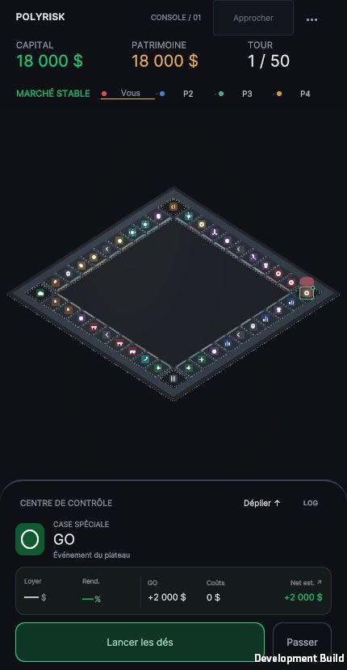
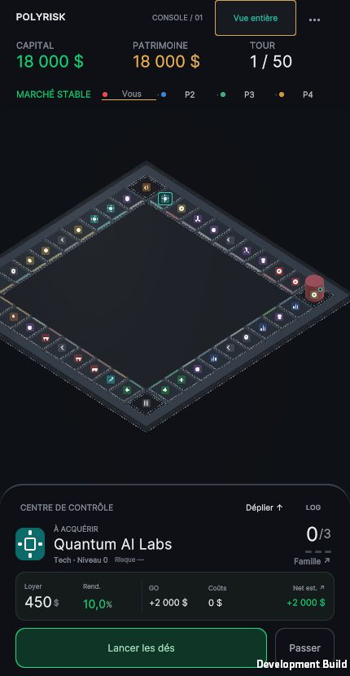
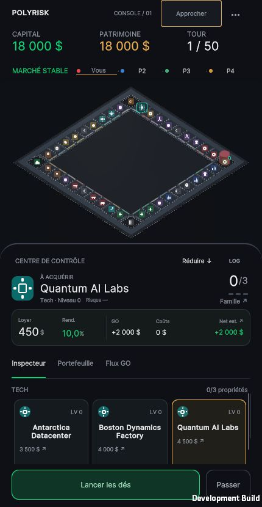
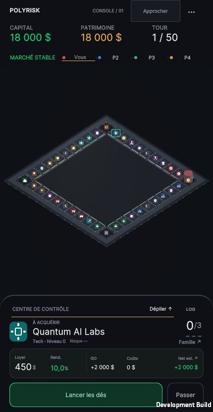
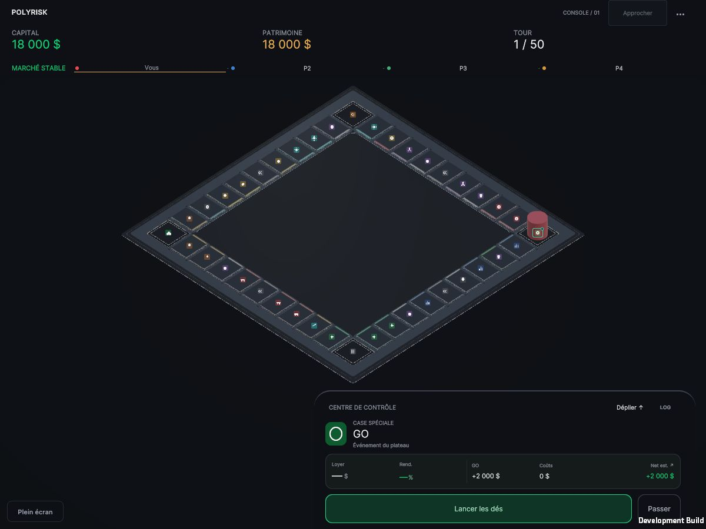
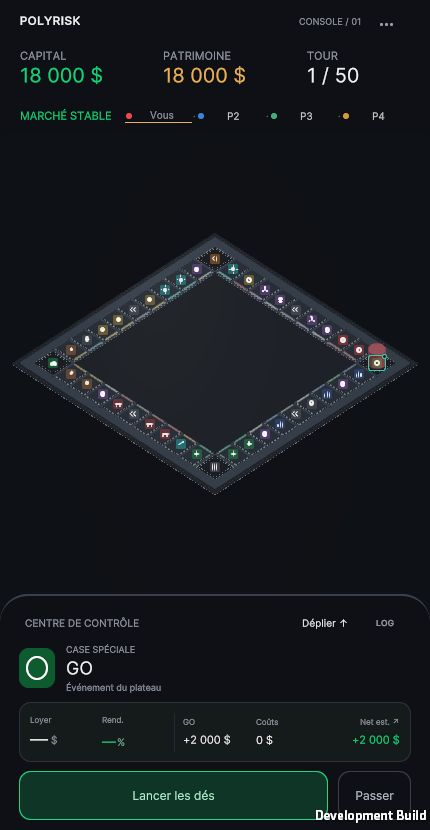

# POLYRISK — PASS 2B.2 · Final Camera Framing & Board Presence

Validation exécutée le **20 octobre 2026**. Le dossier conserve la date d’ouverture de la passe. **Arrêt pour validation artistique après cette livraison.**

L’angle **40° devient le défaut dans tous les builds**, avec projection orthographique et azimut 45°. La présence globale gagne modestement en portrait. La proximité supplémentaire est accessible volontairement après sélection, sans déplacer la caméra au simple tap.

## Captures WebGL réelles demandées

Même canvas 430 × 830, quatre joueurs au GO et 18 000 $ chacun pour les vues de consultation. Aucun achat ni lancer entre ces captures. Images originales, sans retouche ni génération.

| Globale compacte | Case 31 en focus volontaire |
|---|---|
|  |  |

| Cockpit déployé · vue globale | Retour global compact · sélection conservée |
|---|---|
|  |  |

Desktop **1200 × 900**, même état initial :

## Comparatif objectif avec PASS 2B.1

| Avant · B à 40° | Après · globale à 40° | Après · consultation volontaire |
|---|---|---|
|  |  |  |

La largeur globale passe de **406 à 414 px**, soit **+1,97 %**. La hauteur passe de 261,36 à 266,51 px. Ce gain vient uniquement de marges portrait réduites de 12 à 8 unités UI. Il n’est pas présenté comme un agrandissement significatif : le format 430 px et le losange à 40° imposent la limite physique. Un zoom global supérieur couperait les extrémités.

Le focus de la case 31 atteint **×1,25** : épaisseur minimale des empreintes de cases **18,02 px**, contre 14,42 px en globale actuelle et 14,14 px en PASS 2B.1 B. Par rapport à cette dernière, le gain géométrique est d’environ **27,5 %**. Les glyphes restent à 10 px CSS et ne sont pas agrandis dans cette passe.

En déployé global, le board passe de **372,81 × 240 px** à **385,24 × 248 px** ; les 40 colliders restent visibles. [Avant déployé](before-expanded.jpg). Sur desktop, la projection globale reste exactement celle du B précédent : **786,01 × 506 px** ; la hauteur libre est le facteur limitant. [Baseline desktop réelle](before-desktop.jpg), capturée dans l’ancien build avec `boardView=B`.

## Mesures de projection

Les dimensions du board ci-dessous désignent l’enveloppe projetée complète des sommets des quatre meshes. **En focus, une partie de cette enveloppe sort du champ ou passe derrière le HUD/cockpit : 517,5 px ne sont pas 517,5 px visibles sur un écran de 430 px.** La globale conserve toujours les 40 cases.

| État | Board projeté L × H, px | Petit côté min. de case, px | Épaisseur perpendiculaire min., px | Orthographic size |
|---|---:|---:|---:|---:|
| Portrait · globale compacte | 414.0 × 266.5 | 15.85 | 14.42 | 20.25311 |
| Portrait · focus case 31 | 517.5 × 333.1 | 19.81 | 18.02 | 16.20249 |
| Portrait · globale déployée | 385.2 × 248.0 | 14.75 | 13.41 | 21.76510 |
| Portrait · focus déployé | 481.6 × 310.0 | 18.43 | 16.77 | 17.41208 |
| Portrait · retour global | 414.0 × 266.5 | 15.85 | 14.42 | 20.25311 |
| Desktop · globale | 786.0 × 506.0 | 30.09 | 27.37 | 11.56715 |

L’épaisseur minimale est la plus petite hauteur perpendiculaire des parallélogrammes issus des empreintes XZ des colliders ; le petit côté est la plus courte arête projetée. Les faibles arrondis visuels sont exclus de cette mesure de cible rectangulaire. Ce sont des mesures géométriques, pas une preuve du confort au doigt. Le navigateur et le canvas sont vérifiés à 430 × 830 et 1200 × 900, DPR 1. [Données brutes](browser-validation.json).

## Expérience de focus retenue

1. Le tap/clic normal ouvre l’inspecteur existant, sans changement de caméra. Les règles d’inspection et d’action sont conservées.
2. Le bouton **Approcher**, cible de 100 × 44 unités UI dans le HUD, devient disponible après une inspection manuelle autorisée. Ce choix explicite évite les mouvements involontaires à chaque consultation.
3. Le rapprochement est borné entre la vue entière et **×1,25**. Le centre reste celui du board tant qu’il contient la case sélectionnée et le pion actif avec leur marge ; le recentrage est limité au décalage nécessaire pour les garder visibles ensemble.
4. **Vue entière** applique immédiatement le cadrage global, conserve la case inspectée et rend les 40 cases accessibles. Pas de rotation ni de dérive quand la caméra a atteint sa cible.
5. La sélection d’une autre case visible fonctionne pendant le focus : vérification réelle **31 → 32 (Casino)**, sans changement de cadrage dans ce cas. [Preuve](portrait-neighbor-focus.jpg). Les cases hors champ sont accessibles par le retour global.
6. Le focus se ferme si la phase, les permissions d’inspection, le joueur ou sa position changent, ou si un sélecteur d’action prend la main. Le lancer revient donc au parcours complet ; aucun callback de mouvement n’est modifié.

Le cockpit compact/déployé adapte le fit à son `worldBound` réel. Le focus peut rester actif en déployé, avec la case et le pion visibles : [capture supplémentaire](portrait-expanded-focus.jpg). Son retour global déployé est vérifié séparément avant la fermeture du panneau.

**Reduced Motion** applique directement la cible sans interpolation. Focus et retour ont été exécutés dans le navigateur avec cette préférence activée, puis le réglage initial désactivé a été restauré. [Capture](reduced-motion-focus.jpg).

Le cas opposé **case 20 / pion au GO** limite automatiquement le rapprochement à **×1,058**, avec les deux éléments visibles et 40 colliders encore contenus : [preuve](opposite-corners-focus.jpg). Le maximum ×1,25 est une borne, pas une obligation pour chaque sélection.

Aucun pincement ni glissement n’est ajouté : il n’existe donc pas de nouveau conflit geste/tap, ni d’information dépendante du hover.

## Paramètres et architecture

- Élévation 40°, azimut de scène conservé (45°), roulis 0 ; projection orthographique.
- Marges portrait : 8 unités UI après safe area ; desktop/paysage : 12.
- Zoom de consultation : maximum ×1,25 ; padding de la paire case/pion : 12 unités UI.
- Réserve du pion/hop existant : 1,45 unité au-dessus de son ancre. Géométrie et colliders inchangés.
- Transition existante : interpolation exponentielle 18/s, arrêt par convergence ; aucun délai de mouvement revendiqué comme mesure de performance. Retour explicite et Reduced Motion : application directe.
- HUD 134 unités, cockpit compact 236, cran déployé portrait plafonné à 52 % : dimensions conservées.

`BoardInteractionManager` reste l’unique autorité sur la caméra. Il applique 40° au démarrage pour toutes les plateformes et remplace les variantes de développement A/B/C. La scène sérialisée n’est pas réécrite, ce qui préserve ses autres modifications locales. Le contrôleur lit l’inspecteur existant et mémorise uniquement les inspections manuelles réussies. Aucun calcul économique ou tour n’est écrit par la présentation.

## Fichiers modifiés et créés

Cinq fichiers existants modifiés :

- `Assets/Scripts/Systems/BoardInteractionManager.cs` : défaut 40°, marge portrait, focus volontaire borné, invalidation et retour global.
- `Assets/UI/Layouts/TopHUD.uxml` : ajout d’un bouton Approcher/Vue entière.
- `Assets/UI/Styles/Theme.uss` : style de ce contrôle et espace réservé dans la ligne de marque ; édition décorative masquée sous 370 unités pour préserver le contrôle et le menu.
- `Assets/Scripts/Editor/MobileBoardPresenceValidation.cs` : validation du défaut 40°, du fit de consultation, des raycasts et des callbacks de mouvement existants.
- `Assets/Scripts/Debug/MobileBoardValidationProbe.cs` : preuves de focus/phase/Reduced Motion et fixture de mouvement animée invisible, uniquement Editor/Development.

Aucun nouveau contrôleur, package, shader ou asset runtime. Aucun fichier runtime supprimé. Créés dans ce dossier : rapport, 15 JPEG réels (dont quatre baselines), journal de build, données navigateur, inventaires SHA-256, contrôle de périmètre et serveur loopback de capture.

## Tests exécutés et résultats

Unity **2022.3.62f3**, URP **14.0.12**, IL2CPP WebGL Development.

- **612 assertions existantes PASS** : économie 143, mécanique 148, événements 17, UI 304. Les régressions mécaniques incluent les destinations de téléportation/Transit Express et leurs effets économiques.
- **746 contrôles de passe PASS** : 40 indices, quatre meshes fusionnés, 40 raycasts verticaux et 40 raycasts écran au défaut 40° ; 320 configurations de focus (40 cases × deux positions du pion × portrait/desktop × compact/déployé), avec deux assertions par configuration sur le facteur borné et la visibilité case/pion ; contrôle HUD, safe areas/DPR et paysage ; callbacks de mouvement à vide et déplacement direct de type téléportation, une seule exécution, destination exacte.
- **Build WebGL réussi**, `WEBGL PLAYER BUILD PASS`, sortie batch réussie. Aucun `error CS` ni `Shader error` relevé. [Journal](build.log), [résultat](geometry-and-framing.txt).
- **17 relevés de projection réels**, baseline desktop comprise. Inspection case 31 sans mouvement, focus volontaire, autre sélection pendant le focus, déploiement et retour global exact ; mêmes pose et taille retrouvées en portrait et desktop.
- **Mouvement animé existant** : fixture invisible 1 → 2 → 3 en WebGL, callback exactement une fois, destination et échelle finales exactes, en modes normal et Reduced Motion. Aucun pion réel ni état économique modifié par cette fixture.
- **Partie réelle** : lancer depuis le focus sur Casino, arrivée case 7 Venture avec vue globale rétablie et position logique 7. [Capture d’arrivée](portrait-roll-global.jpg). Ce n’est pas une capture du court instant de lancer de dés.
- Aucune erreur console de niveau `error` relevée dans les sessions desktop et Reduced Motion contrôlées. Les états de consultation restent tous à 18 000 $ / position 0 / aucune propriété pour les quatre joueurs ; les deux relevés après lancer sont identifiés séparément.
- **581 fichiers Assets/ProjectSettings identiques** à l’inventaire de début de passe : RulesEngine, économie, inspecteur, scènes, board, ancres/colliders, shaders/matériaux, PawnMovement/callbacks et réseau conservés. Le routage des entrées/permissions est identique, avec la seule mémorisation de l’inspection manuelle pour le focus. [Vérification](scope-validation.json) ; `python3 Docs/Validation/CameraPresence_2026-10-19/verify_scope.py` depuis le projet.

## Limites et suite

La proximité repose sur un compromis explicite : en focus case 31 compact, 35 colliders sont entièrement dans la zone libre et certaines extrémités sont hors champ. En globale, 40/40 sont contenus. En déployé focus, une partie du board peut passer derrière le HUD ou le cockpit ; la case inspectée et le pion actif restent visibles. La transition du cockpit peut aussi provoquer une occultation transitoire de la périphérie. Aucun coin n’est définitivement inaccessible, le retour global reste dans le HUD.

Les cibles minimales restent petites (14,42 px global, 18,02 px au focus maximal testé) et ne deviennent pas des cibles de 44 px. Les pions superposés au GO conservent leur comportement existant. Le menu desktop présente toujours son ancien contenu volumineux défilable ; aucune refonte du lobby n’est incluse.

Les interactions ont été exécutées avec le navigateur desktop dans les formats demandés, pas sur téléphone physique. Aucun profil GPU, draw calls, frame time, consommation mémoire mobile, build iOS/Android ou test réseau multi-client n’est revendiqué. La téléportation logique et le contrat de callback direct sont couverts par les tests ; aucun trajet réseau réel de téléportation n’a été joué ici.

**Prochaine action : validation artistique de la vue globale à 40° et du focus volontaire. Arrêt après PASS 2B.2 ; aucun travail sur les pions, FX ou états visuels n’est engagé.**
