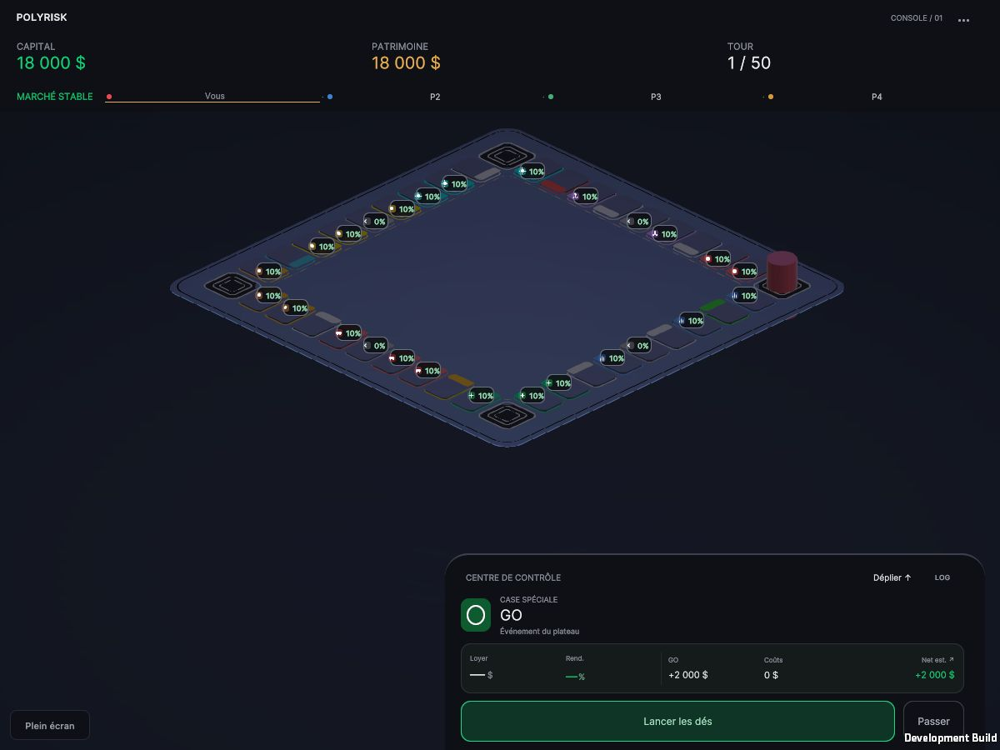
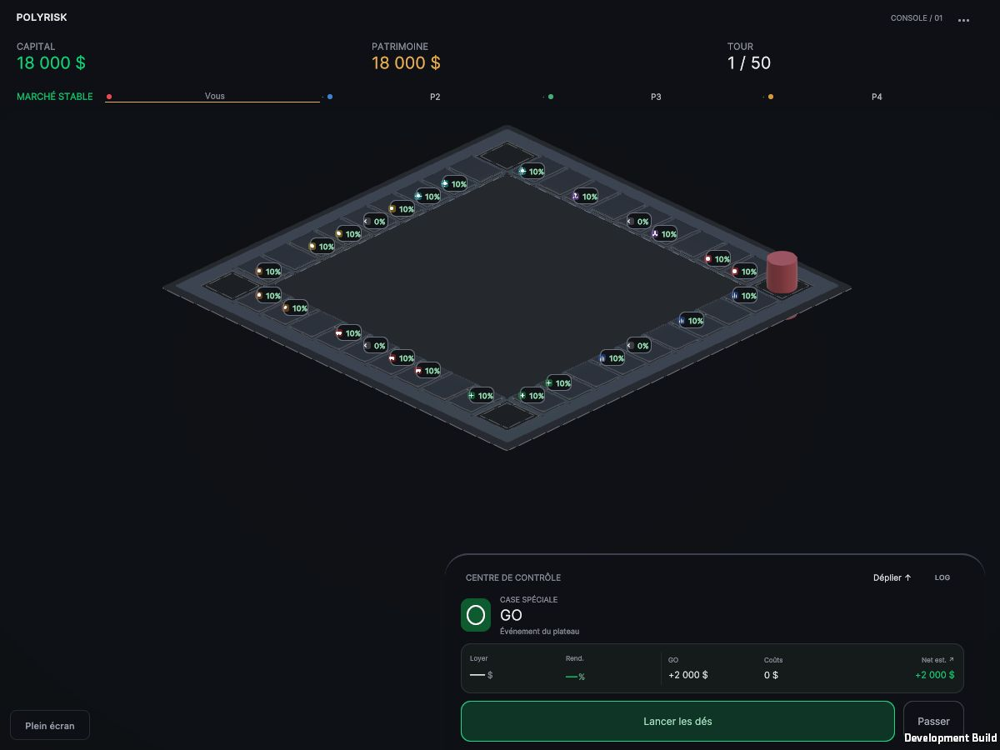

# Graphite Foundation — PASS 2A

PASS 2A uniquement. Arrêt pour validation artistique : aucun travail sur les nouveaux pions, la composition d'états ou le cadrage contextuel n'est commencé.

## Captures réelles

Deux exports Unity 2022.3.62f3 / URP 14.0.12 / WebGL Development, exécutés dans le même navigateur desktop. Images JPEG du canvas, sans retouche ni génération d'image. Dimensions vérifiées : desktop **1200 × 900**, portrait **430 × 830**, DPR 1.

Même point de départ : partie locale à quatre joueurs, premier tour humain, capital et patrimoine 18 000 $, sans lancer de dés. Les captures GO n'ont aucune propriété inspectée. La seconde série inspecte **Quantum AI Labs, case 31**, sans déplacement ni achat. Le clic au même pixel (239, 272) sélectionne bien l'index 31 dans les deux exports.

| État | Avant | Après |
|---|---|---|
| Desktop, GO compact | [Avant](before-desktop.jpg) | [Après](after-desktop.jpg) |
| Portrait, GO compact | [Avant](before-portrait-compact.jpg) | [Après](after-portrait-compact.jpg) |
| Portrait, GO déployé | [Avant](before-portrait-expanded.jpg) | [Après](after-portrait-expanded.jpg) |
| Portrait, propriété compacte | [Avant](before-property-compact.jpg) | [Après](after-property-compact.jpg) |
| Portrait, propriété déployée / occlusion | [Avant](before-property-expanded.jpg) | [Après](after-property-expanded.jpg) |

La capture `reference-existing-compact.jpg` est une référence exploratoire de l'export Pulse précédent ; elle ne sert pas à la comparaison compilée ci-dessus.





## Paramètres livrés

Le thème `Assets/Settings/GraphiteFoundation/GraphiteTheme.asset` est prioritaire sur les anciens gris et ratios du composant. Les anciennes valeurs restent disponibles pour les scènes sans thème.

| Paramètre | Avant | PASS 2A |
|---|---:|---:|
| Largeur courte standard | 0,92 | 0,92, inchangée |
| Épaisseur de tuile | 0,086 (~9,3 %) | **0,0414 (4,5 %)** |
| Rayon d'angle des tuiles | 17 % | **2,5 %** |
| Subdivisions par angle | 9 | **3** |
| Largeur de rainure | 0,05 | **0,01288 (1,4 %)** |
| Bande de catégorie | 24 % de la profondeur | **0,01656 (1,8 % de la petite largeur)** |
| Rayon extérieur du cadre | 0,55 | **0,08** |
| Hauteur supérieure standard | 0,096 | **0,096, inchangée** |
| Socle / deckThickness | 0,03 | **0,03, inchangé** |
| Métal du cadre | 0,506 | **0,25** |
| Smoothness du cadre | 0,917 | **0,32** |
| Métal des tuiles | 0,158 | **0,12** |
| Smoothness des tuiles | 0 | **0,23** |
| Émission de repos avant facteur 0,22 | 0,8 | **0,65** |
| Saturation des catégories au repos | 100 % | **50 %** |
| Accent extérieur | blanc, intensité 1,04 | teinte du contour, **0,12** |
| Réflexion simulée | absente | **0,035**, atténuation **0,12 unité** |
| Bloom : intensité / seuil / dispersion | 0,55 / 0,8 / 0,35 | **0,08 / 1,15 / 0,20** |
| Color Adjustments : exposition / contraste / saturation | 0,05 / 12 / 4 | **0,15 / 6 / -8** |
| Vignette | 0,18, teinte bleutée | **0,10**, teinte neutre |

Palette sRGB du thème : socle **#171D25**, cases **#252D37**, contours **#3A4551**, centre **#141A22**, gravures **#0F141B**, fond **#0C1016**. Les valeurs affichées à l'écran dépendent de l'éclairage et du tonemapping ; les couleurs des sommets sont converties en linéaire avant rendu.

Une directionnelle neutre (237/240/244, intensité 1,05) remplace la dominante bleue. Les deux points vert/violet sont désactivés. Fond unlit sombre, brouillard retiré, ambiance plate neutre. La probe temps réel est désactivée dans la scène ; elle l'était déjà au démarrage dans le WebGL précédent.

La réflexion est une atténuation analytique sur le bord intérieur des tuiles, colorée par la texture d'état existante. Ce n'est ni un éclairage indirect physique ni une réflexion de la scène. Aucune lumière par case, cubemap temps réel, géométrie ou passe supplémentaire pour cet effet.

## Fichiers

**Fichiers existants modifiés uniquement :**

- `Assets/Scripts/Board/PolyRiskBoard.cs` : branche optionnelle de thème, couleurs par région, géométrie plus fine, reconstruction des seuls meshes en conservant les ancres.
- `Assets/Scenes/SampleScene.unity` : quatre meshes régénérés, branchement des nouveaux assets et ambiance statique neutre. Caméra : seule sa couleur de fond change.

**Fichiers créés :**

- `Assets/Scripts/Board/BoardVisualTheme.cs` et son `.meta`.
- `Assets/Shaders/GraphiteSurface.shader` et son `.meta` : shader URP opaque, lumière et spéculaire sobres, couleur par sommet et reflet local simulé ; bloc de matériau commun aux passes.
- `Assets/Scripts/Editor/GraphiteFoundationValidation.cs` et son `.meta` : application explicite et vérifications ; aucune exécution automatique au jeu.
- `Assets/Settings/GraphiteFoundation/GraphiteTheme.asset`.
- `Assets/Settings/GraphiteFoundation/GraphitePost.asset`.
- `Assets/Settings/GraphiteFoundation/GraphiteFrame.mat`, `GraphiteTiles.mat`, `GraphiteEngraving.mat`, `GraphiteAccents.mat`, `GraphiteBackground.mat` ; métadonnées Unity associées et du dossier.
- Ce dossier de validation : captures, baselines, scripts de recette, journaux, inventaires et rapports.
- Exports séparés : `Builds/GraphiteBaseline` et `Builds/GraphiteFoundation`.

Les matériaux originaux et `PolyRisk_PostProfile.asset` restent inchangés. Le shader lit les couleurs par sommet pour différencier les régions d'un même mesh, au lieu d'ajouter des renderers ou des matériaux par case.

## Validations réellement exécutées

- Compilation C# et export WebGL final réussis, **sans erreur de shader** dans le journal final. Le premier shader avait une inclusion URP manquante dans la passe d'ombres (`LerpWhiteTo` / `CommonMaterial.hlsl`) ; elle a été corrigée puis la cible recompilée. Les tentatives précédentes restent archivées et ne constituent pas la livraison.
- **612 assertions existantes réussies** : économie 143, mécaniques 148, événements 17, assets UI 304 sur 17 écrans/composants.
- **40 ancres, indices uniques 0–39**, signatures de transforms et colliders inchangées pendant la régénération ; 40 raycasts verticaux réussis, 36 hauteurs de surface standard préservées, quatre meshes conservés et cadrage inchangé.
- Vérification supplémentaire des fichiers de scène : les **40 GameObjects d'ancre et tous leurs composants sérialisés sont identiques** à la baseline, avec les mêmes identifiants de fichier.
- `verify_scope.py` : seuls les deux fichiers existants listés ci-dessus changent ; **556 fichiers préexistants conservés** selon les empreintes prises avant cette passe. RulesEngine, économie, mouvements/callbacks, pions, contrôleurs d'entrée/caméra, UI et protocole réseau sont préservés.
- Exécution WebGL dans le navigateur, démarrage local, déploiement/réduction du panneau, clic réel sur la case 31 avant et après. Aucune erreur ni alerte dans les consoles des vues desktop et portrait testées.
- Inspection des JPEG enregistrés et vérification de leurs dimensions. Le contrôle des espaces ignore les espaces de fin de champ vide produits par le sérialiseur Unity ; les scripts ne contiennent pas de défaut d'espace détecté.

| Géométrie du plateau | Avant | Après |
|---|---:|---:|
| Meshes rendus | 4 | 4 |
| Sommets | 108 160 | 42 240 |
| Triangles | 47 840 | 18 624 |

Ces comptes proviennent des meshes Unity réels ; ils ne mesurent ni les draw calls complets d'une frame ni le temps GPU. `surface-validation-original.txt` conserve le premier relevé avant/après ; `surface-validation.txt` décrit la dernière exécution idempotente.

Preuves : `foundation-build.log`, `baseline-build.log`, `scope-validation.json`, `anchor-signatures.txt`, `browser-validation.json`, `artifact-inventory.json`. Les métriques mémoire et temps présentes dans les journaux d'Editor ne sont pas utilisées comme mesures du jeu.

## Limites constatées et arrêt

- L'inspecteur de propriété déployé masque toujours une partie du parcours. L'occlusion est visible dans les captures ; aucun correctif de caméra/UI n'est introduit.
- Les badges financiers existants dominent encore la lecture en portrait. Les accents très fins deviennent parfois subpixel à 430 px ; leur visibilité et la faible réflexion simulée sont à juger artistiquement sur ces captures.
- Pions, superpositions et feedbacks actuels sont conservés. Le shader ne résout pas les conflits de composition des états ; ce chantier n'est pas commencé.
- Tests effectués sur navigateur desktop avec viewport portrait. **Aucun téléphone physique, Safari iOS, build natif Android/iOS ou mesure comparative de fps, mémoire GPU, draw calls et coût du post-processing n'est revendiqué.** Les exports sont Development.
- La compilation ne constitue pas une validation artistique. Prochaine action : revue des captures par Arthur ; attendre sa validation avant toute autre passe.

## Reprise et réglages

Après un changement géométrique ou de palette, utiliser `Rebuild static surfaces (preserve anchors)` sur PolyRiskBoard. Le menu explicite `PolyRisk/Graphite Foundation/Apply and verify static surfaces` applique aussi l'environnement et vérifie les invariants. Garder `tileSurfaceY` à 0,096 pour ces ancres.

Ne pas relancer l'ancien menu Cyber-Luxury : il rétablit son ambiance antérieure. Les anciennes ressources sont conservées pour une reprise ciblée ; retirer seulement le thème ne restaure pas les anciens matériaux assignés.

Serveur local depuis la racine du projet :

```sh
python3 Docs/Validation/GraphiteFoundation_2026-10-18/serve_webgl.py --build-root Builds --port 8988
```

Exports : `http://127.0.0.1:8988/GraphiteBaseline/` et `http://127.0.0.1:8988/GraphiteFoundation/`.
