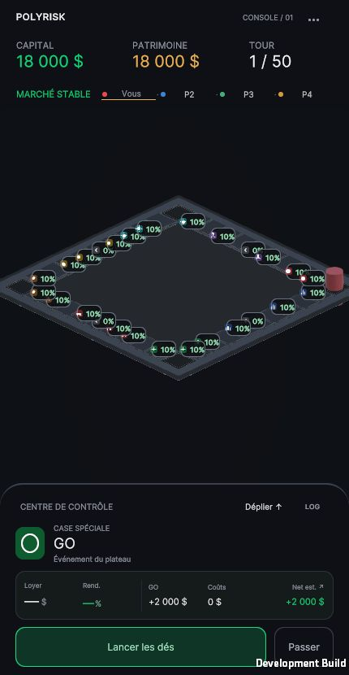
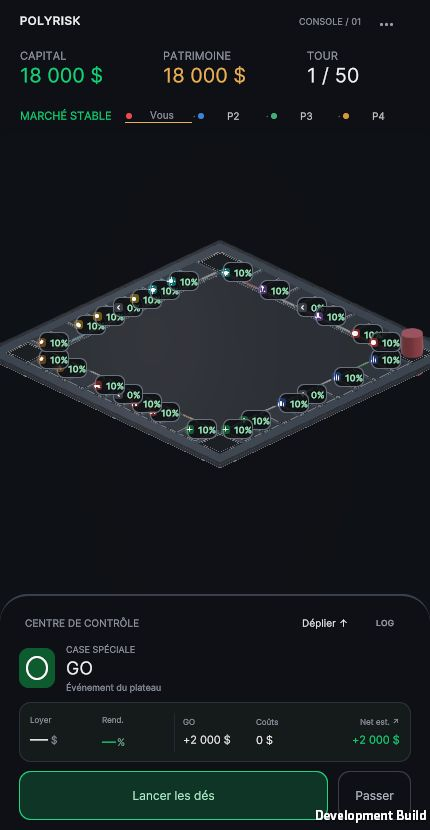
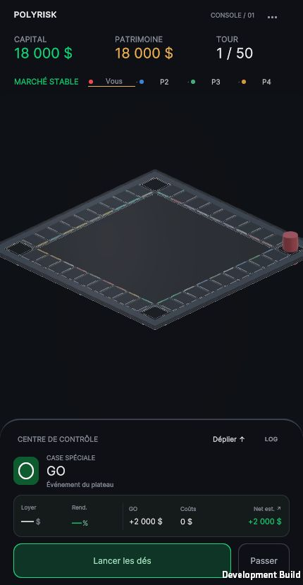

# PolyRisk — PASS 2A.1 / Graphite Visual Refinement

19 octobre 2026. Périmètre : finition statique uniquement. Validation artistique à réaliser sur les captures WebGL ci-dessous. Aucun démarrage de PASS 2B.

## Référence et décisions

[Image fournie par Arthur](art-reference.jpg) : graphite satiné, arêtes métalliques, réflexions colorées proches des liserés. Adaptation : conserver les cases beaucoup plus fines de PASS 2A, limiter couleur et émission, garder le centre calme. Aucun bâtiment, pion ou élément UI de la référence repris.

Les couleurs de base, la scène, les lumières, la caméra, le fond et le profil de post-traitement restent identiques à PASS 2A. La séparation repose sur la réponse des matériaux et les arêtes. Le shader ajoute une réflexion analytique d'un large panneau neutre virtuel, modulée par la vue, les normales et la matière. Ce panneau est une approximation de rendu, pas une lumière ou un objet ajouté à la scène.

Les normales d'arête sont infléchies dans une très petite zone intérieure à l'empreinte existante. La bande lumineuse est reconstruite dans le fragment shader à partir des coordonnées du plateau et de l'index UV2 existant. `fwidth` aide sa couverture à la résolution de rendu. Le reflet coloré décroît exponentiellement puis est annulé à 0,10 unité. Il utilise la texture d'état déjà présente : aucune texture procédurale supplémentaire, probe temps réel, lumière colorée ou passe supplémentaire.

## Captures réelles

Toutes les images sont des captures JPEG du navigateur, sans retouche. Même cadrage par format, nouvelle partie locale, tour 1, GO, quatre joueurs, capital et patrimoine 18 000 $, aucun lancer ni achat avant capture. Les images PASS 2A proviennent de la livraison précédente ; les sources ont été vérifiées identiques au début de cette itération (`baseline-identity.json` et inventaires SHA-256).

| PASS 2A — 1200 × 900 | PASS 2A.1 — 1200 × 900 |
| --- | --- |
|  |  |

| PASS 2A — portrait compact | PASS 2A.1 — portrait compact | PASS 2A.1 — isolation artistique |
| --- | --- | --- |
|  |  |  |

Portrait : viewport et canevas 430 × 830, DPR 1, navigateur desktop redimensionné. Ce n'est pas une exécution sur téléphone. [Vue desktop isolée complémentaire](pass2a1-desktop-isolation.jpg).

L'isolation masque temporairement le conteneur des badges (icône de famille et pourcentage). Elle ne modifie aucune donnée financière. Build de développement uniquement : `?graphiteIsolation=1` au lancement, ou F10 pour masquer/restaurer. Aucun état persistant sauvegardé. Le code est exclu des builds non Development, hors déclaration vide de classe.

## Bilan visuel observé

Les captures montrent des arêtes plus présentes et une variation neutre douce sur la surface du plateau ; les couleurs restent concentrées près des bandes intérieures. Le centre conserve son rôle calme. L'écart reste mesuré : à 430 px, les cases disposent de très peu de pixels et le rendu de matière est discret. La référence comporte des cases beaucoup plus grandes à l'écran et un éclairage plus affirmé ; sa qualité perçue n'est donc pas déclarée atteinte. Les badges dominent encore la lecture normale et les extrémités latérales restent proches des bords du viewport. Aucun élargissement de périmètre pour corriger ces limites.

Preuves fonctionnelles complémentaires : [sélection de l'index 31](selection-index31.jpg), [badges restaurés après F10](badges-restored-qa.jpg). Le contour bleu de cette dernière preuve est le focus clavier du navigateur, absent des captures artistiques lancées par URL.

## Paramètres exacts

Valeurs de shader/contrôle artistique, pas des unités photométriques.

| Paramètre | PASS 2A | PASS 2A.1 |
| --- | ---: | ---: |
| Socle/contours — metallic | 0,25 | 0,40 |
| Socle/contours — smoothness | 0,32 | 0,52 |
| Cases — metallic | 0,12 | 0,28 |
| Cases — smoothness | 0,23 | 0,44 |
| Émission de repos du thème | 0,65 | 1,20 |
| Multiplicateur de repos existant | 0,22 | 0,22 (inchangé) |
| Émission du contour architectural | 0,12 | 0,18 |
| Saturation des accents de catégorie | 0,50 | 0,62 |
| Multiplicateur néon | 1,00 | 1,50 |
| Force du reflet coloré simulé | 0,035 | 0,18 |
| Distance de demi-décroissance du reflet | 0,12 | 0,025 unité |
| Extinction complète du reflet | Pas de coupure dédiée | 0,10 unité |
| Réflexion satinée neutre socle/contours | Absente | 0,30 |
| Réflexion satinée neutre cases | Absente | 0,24 |
| Réflexion satinée neutre gravures | Absente | 0,025 |
| Force de normale virtuelle d'arête | Absente | 0,20 |
| Zone de normale d'arête | Absente | 0,85 pixel de rendu |
| Assistance de couverture des bandes | Absente | 1,20 pixel de rendu |

La réflexion neutre et les normales sont de nouveaux contrôles du thème. La gravure conserve metallic 0 et smoothness 0,10 ; son faible satin est un réglage du raccord matériau.

**Géométrie inchangée** : épaisseur relative 4,5 %, rayon relatif 2,5 %, rainures 1,4 %, bande de catégorie 1,8 %, trois segments par arrondi, rayon de cadre 0,08, surface Y 0,096. Cases standards : 0,92 × 1,32, épaisseur 0,0414, bande géométrique 0,01656 unité. Aucun nouveau sommet. Quatre meshes fusionnés : 42 240 sommets, 18 624 triangles.

**Ambiance inchangée** : palette graphite de PASS 2A ; fond #0C1016 ; bloom intensité 0,08, seuil 1,15, scatter 0,20 ; aucune réflexion probe temps réel. L'effet lumineux reste localisé.

## Fichiers

Modifiés par rapport à l'état local au début de PASS 2A.1 (et non par rapport à HEAD, qui comprend déjà beaucoup de travail local) :

- `Assets/Scripts/Board/BoardVisualTheme.cs` — paramètres de finition.
- `Assets/Scripts/Board/PolyRiskBoard.cs` — raccord des paramètres et rafraîchissement des seuls matériaux.
- `Assets/Shaders/GraphiteSurface.shader` — satin analytique, arêtes et bandes antialiasées, reflet court.
- `Assets/Settings/GraphiteFoundation/GraphiteTheme.asset`.
- `Assets/Settings/GraphiteFoundation/GraphiteFrame.mat`.
- `Assets/Settings/GraphiteFoundation/GraphiteTiles.mat`.
- `Assets/Settings/GraphiteFoundation/GraphiteEngraving.mat`.
- `Assets/Settings/GraphiteFoundation/GraphiteAccents.mat`.

Créés :

- `Assets/Scripts/Debug/GraphiteVisualIsolation.cs` et `.meta` — contrôle QA temporaire.
- `Assets/Scripts/Editor/GraphiteRefinementValidation.cs` et `.meta` — recette reproductible, vérifications et build.
- Le présent dossier de validation : référence, captures, baseline, journaux et preuves SHA-256.
- Build local `Builds/GraphiteRefinement` (sortie générée).

`RulesEngine`, économie, indexation, génération des meshes/ancres, colliders/raycasts, callbacks de PawnMovement, pions, UI de production, composition des états et cadrage conservés.

## Validations et limites

Résultats détaillés : `build.log`, `surface-validation.txt`, `scope-validation.json`, `browser-validation.json`, `artifact-hashes.json`.

- Compilation Unity 2022.3.62f3 / IL2CPP WebGL Development et shader URP : réussies.
- Régressions existantes : 612 assertions réussies (économie 143, mécaniques 148, événements 17, UI 304).
- Quatre meshes inchangés ; 40 indices uniques ; ancres/colliders identiques ; 40 raycasts verticaux réussis ; caméra identique.
- Scène et meshes intégrés : identiques octet pour octet à la baseline.
- Huit fichiers préexistants modifiés dans le périmètre ; 572 fichiers inventoriés préexistants conservés ; aucun changement inattendu.
- Exécution réelle du build final : desktop 1200 × 900 et portrait 430 × 830 / DPR 1 ; aucune alerte ni erreur console dans les sessions capturées.
- Sélection : tap (239,272) → index 31, Quantum AI Labs ; inspecteur correctement affiché.
- Isolation : lancement sans badges réussi ; F10 restaure visuellement les badges, capital/patrimoine conservés à 18 000 $.

L'assistance à 1,20 pixel concerne le framebuffer et reste bornée par l'empreinte des cases : pas de garantie universelle après réduction CSS, autre DPR, occlusion ou sur tous les GPU. Aucun test iOS/Android physique, Safari mobile ou build Release dans cette itération. Pas de mesure fiable de draw calls, mémoire GPU, durée de frame ou coût post-processing ; l'ajout de calculs fragment n'est pas présenté comme gratuit.

Les badges continuent d'occulter les cases dans le fonctionnement normal. La taille du board, le cadrage portrait et la silhouette actuelle des pions restent les limites visibles du périmètre approuvé. Le résultat doit être jugé sur les captures : la compilation seule ne valide pas la qualité artistique.

## Reproduction

Unity : menu `PolyRisk > Graphite Foundation > Apply PASS 2A.1 materials only`. Aucun appel à Generate et aucune sauvegarde de scène dans cette recette.

Build : méthode batch `PolyRisk.Editor.GraphiteRefinementValidation.ApplyAndBuild`, variable `POLYRISK_WEBGL_OUTPUT` vers `Builds/GraphiteRefinement`.

Serveur local : `python3 Docs/Validation/GraphiteRefinement_2026-10-19/serve_webgl.py --build-root Builds --port 8996`.

Vue normale : `http://127.0.0.1:8996/GraphiteRefinement/`. Isolation QA : même URL avec `?graphiteIsolation=1`. Choisir Play Local ; capturer avant l'expiration de la phase de préparation existante.

Prochaine action : validation artistique d'Arthur sur ces images ; ajuster uniquement la finition si nécessaire. Aucun travail sur les pions, les états ou le cockpit sans cette validation.
