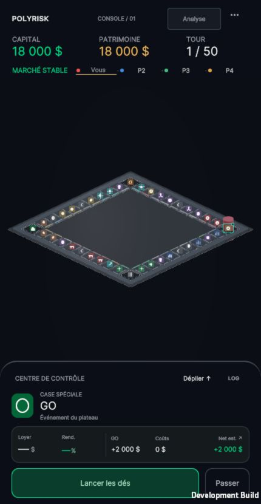
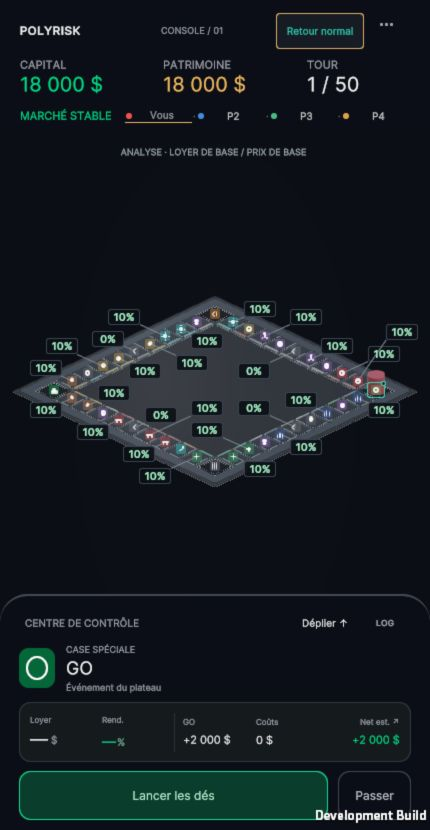
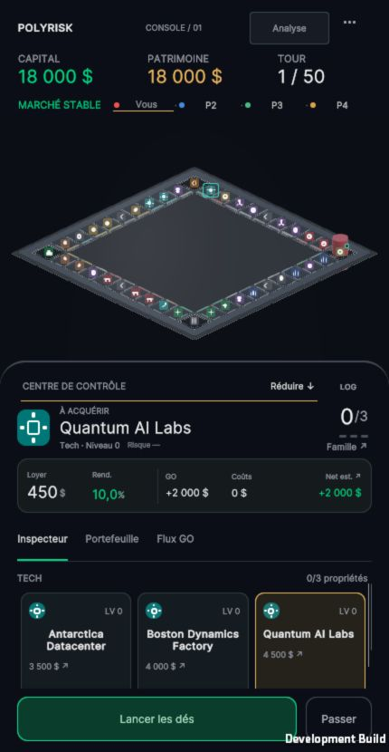
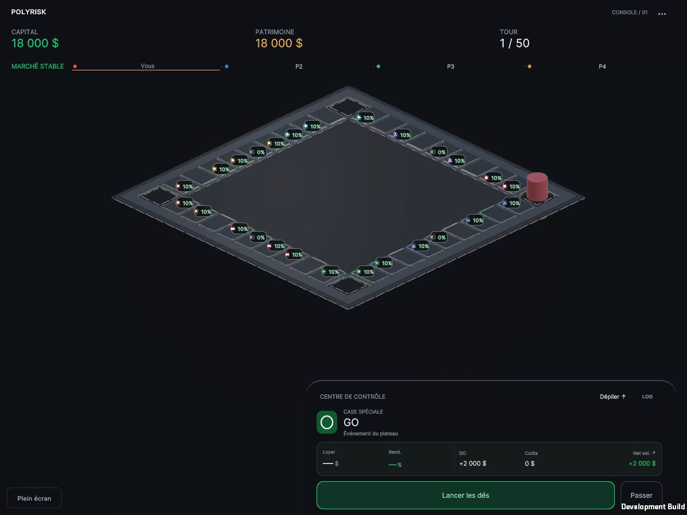
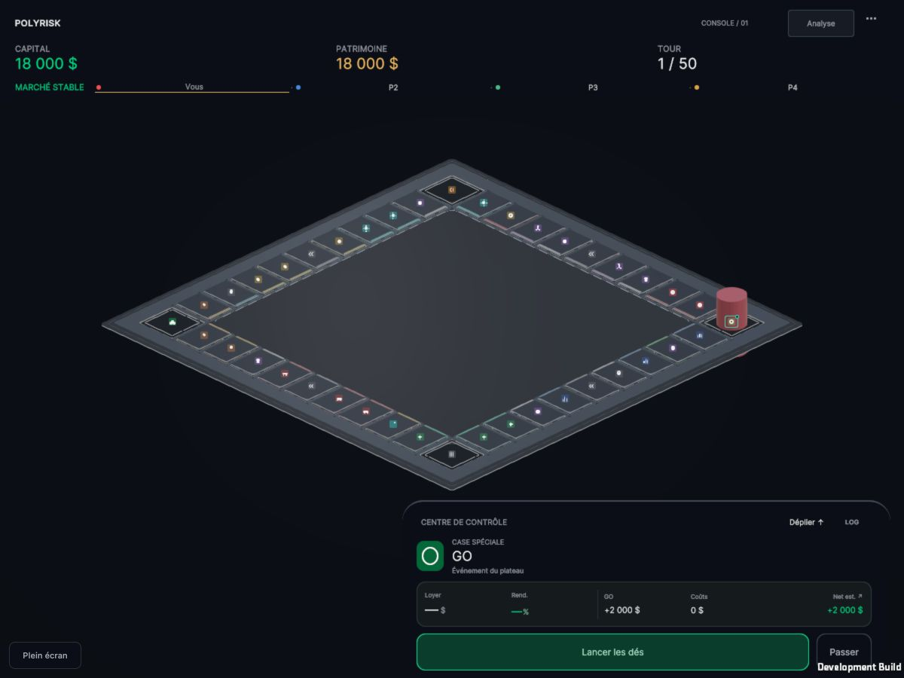

# PolyRisk — PASS 2B / Mobile Board Presence & Contextual Information

19 octobre 2026. Fondation PASS 2A.1 conservée. Aucune poursuite vers les pions ou les shaders.

## Mini-audit et choix minimaux

- `BoardInteractionManager` était et reste le seul auteur de la position et de la taille orthographique de la caméra. Ancien portrait : cadrage des centres des ancres, sans empreinte complète du socle ni dimensions du cockpit. Le seuil `Screen.width <= 430` portait sur les pixels de rendu : il ne correspondait pas toujours à un viewport CSS 430 px en haute densité.
- `UIUXRuntime` prépare les PanelSettings, les classes responsive et les marges de sécurité. Les racines HUD/cockpit sont absolues : leur position est désormais ajustée explicitement. WebGL lit aussi les `env(safe-area-inset-*)` du navigateur, convertis en pixels de rendu ; intersection avec l'information native, sans cumul des insets.
- `ActionButtonsWidget` et `PulseSheetMotion` conservent les actions et les deux crans existants. Seul un getter en lecture seule expose l'index inspecté. Le cockpit déployé est plafonné à 52 % de sa zone sûre en portrait étroit ; son contenu détaillé reste défilable et les actions restent à sa base.
- `BoardTileOverlayWidget` était l'unique source des pourcentages permanents, monté par `TopHUDWidget`. Il conserve la formule et les sources de rendement de base ; il présente désormais les deux modes. Aucun changement de TopHUDWidget ou du moteur économique.

À 430 px, la largeur limite déjà le losange isométrique. Agrandir uniformément en conservant l'angle couperait les coins. La proposition implémentée privilégie l'empreinte complète, des marges de 12 unités UI, des identités plus sobres et une adaptation au cockpit. Le gain de présence vient de la composition et de la suppression du bruit ; aucun agrandissement artificiel n'est annoncé en portrait.

## Cadrage

Le contrôleur fournit également cette même zone à `PulseCenterStage` : les dés et événements existants se redimensionnent avec leur host, et ne gardent plus une zone compacte derrière le cockpit déployé. Aucun callback de mouvement ou de dés modifié.

Le contrôleur mesure les quatre meshes fusionnés, projette leurs bornes dans les axes fixes de la caméra, et réserve 1,45 unité verticale pour le pion existant et son saut. Il choisit la plus grande zone exploitable entre HUD et cockpit ; en paysage, il compare aussi les zones latérales libres. Il ajuste seulement translation et taille orthographique, sans changer la rotation.

La zone est recalculée quand le layout ou le viewport change. Un amortissement exponentiel sans oscillation accompagne les deux crans ; Reduced Motion applique immédiatement la cible. Une fois la cible atteinte, aucun nouvel écrit du transform n'est nécessaire. La caméra ne change pas de cadrage à chaque tour ou lancer de dés.

## Modes d'information

**Normal par défaut** : 40 glyphes discrets, aucun rendement répété, marque de propriétaire colorée distincte, contour de sélection, repère du joueur actif. Les valeurs détaillées restent dans l'inspecteur. Les marqueurs ne capturent pas les clics : raycast et routage inchangés.

**Analyse** : bouton tactile/clavier dans le HUD, légende permanente `LOYER DE BASE / PRIX DE BASE`, pourcentages issus de la formule précédente. Petites étiquettes déplacées près de leurs cases, avec traits de liaison et placement évitant les autres étiquettes et les marqueurs d’identité/propriété/sélection. Le bouton `Retour normal` retire immédiatement la couche. Aucune préférence persistée ou modification de l'état de jeu.

Le layout des marqueurs reçoit les changements de cadrage et vérifie sa signature à 33 ms pendant les transitions et reste inchangé quand sa signature est stable. Les propriétaires sont lus dans un cache réutilisé, rafraîchi à 150 ms ; aucune recherche d'owner allouant un wrapper par case à chaque frame. Aucun changement de modèle ou d'état graphique des meshes.

## Captures réelles WebGL

| PASS 2A.1 — portrait 430 × 830 | PASS 2B — normal compact |
| --- | --- |
|  |  |

| Analyse compacte | Cockpit déployé |
| --- | --- |
|  |  |

| PASS 2A.1 — desktop 1200 × 900 | PASS 2B — desktop |
| --- | --- |
|  |  |

Captures navigateur JPEG sans retouche. Baselines réelles de PASS 2A.1 archivées, sources vérifiées par SHA-256 avant modification. Les vues compactes comparatives utilisent une nouvelle partie locale, quatre joueurs, tour 1, GO, capital/patrimoine 18 000 $. Les autres états de test sont décrits dans `browser-validation.json`.

## Paramètres de présentation

| Paramètre | Valeur |
| --- | --- |
| Marge du plateau | 12 unités UI, converties en pixels de rendu |
| Réserve verticale pour pion et saut existants | 1,45 unité monde |
| Réponse du cadrage | amortissement exponentiel 18/s ; immédiat en Reduced Motion |
| Cockpit déployé en portrait étroit | maximum 52 % de sa zone sûre |
| Identité de case | empreinte 18 × 16 ; glyphe 10 × 10 unités UI |
| Rendement d'analyse | 32 × 16 ; texte 10 unités UI |
| Placement d'analyse | jusqu'à 24 candidats autour de la case ; pas de 17 unités ; marges anti-collision |
| Réserve devant le menu pour Analyse | 46 unités UI |
| Vérification des marqueurs / cache propriétaire | 33 ms / 150 ms |

## Fichiers

Modifiés dans cette passe (comparaison au working tree de départ, pas à HEAD) :

- `Assets/Scripts/Systems/BoardInteractionManager.cs` : cadrage, même contrôleur et même routage d'entrée.
- `Assets/Scripts/UI/BoardTileOverlayWidget.cs` : identités et analyse.
- `Assets/Scripts/UI/ActionButtonsWidget.cs` : getter de l'index inspecté uniquement.
- `Assets/Scripts/UI/UIUXRuntime.cs` : insets des racines absolues, pont safe area WebGL, passage des clics dans le conteneur vide du cockpit, zone de présentation alignée sur le viewport libre.
- `Assets/Plugins/WebGL/PulseViewport.jslib` : lecture des insets CSS, aucun appel réseau.
- `Assets/UI/Layouts/TopHUD.uxml` : bouton Analyse et légende.
- `Assets/UI/Styles/Theme.uss` : marqueurs, analyse, plafond du cockpit déployé.

Créés : `MobileBoardPresenceValidation.cs` (Editor), `MobileBoardValidationProbe.cs` (Debug), leurs `.meta`, ce dossier de preuves et le build généré `Builds/MobileBoardPresence`.

La scène et ses meshes intégrés, les 40 ancres/colliders, les matériaux et shaders PASS 2A.1, RulesEngine, calculs économiques, PawnMovement, les pions et le protocole réseau restent identiques au départ. `verify_scope.py` vérifie le périmètre et l'identité du routage des raycasts.

## Validations et limites

Vérification navigateur du build final : 40 ancres et 40 colliders dans la zone libre dans les quatre captures. 0 rendement en normal ; 26 en analyse ; 0 chevauchement entre rendements. Retour normal vérifié visuellement, sélection de l'index 31 correcte, menu accessible. La signature soldes/positions/nombre de propriétés reste identique avant/après les bascules et l'inspection.

Les mesures sont faites sur des layouts stabilisés. L’ouverture du menu a également été vérifiée. Les sessions comparatives ne signalent pas d’erreur runtime.

Un lancer manuel puis l'achat réel du Hub à l'index 5 ont été exécutés : prix 1 000 $, solde logique 18 000 → 17 000 $, propriété détenue 0 → 1 et un marqueur propriétaire visible. Ces modifications de partie résultent des actions normales, pas de la présentation.

| Espace mesuré (pixels de rendu, origine bas gauche) | Zone libre | Cockpit |
| --- | --- | --- |
| Portrait normal compact | x12 y248 · 406 × 436 | x0 y0 · 430 × 236 |
| Portrait analyse compacte | x12 y248 · 406 × 408 | x0 y0 · 430 × 236 |
| Portrait déployé, Quantum AI Labs inspecté | x12 y444 · 406 × 240 | x0 y0 · 430 × 432 |
| Desktop compact | x12 y248 · 1176 × 506 | x534 y0 · 648 × 236 |

La zone de présentation des événements est identique à cette zone libre dans les quatre mesures. Les boutons d'action restent au bas de l'écran, hors de la zone du plateau.

Les résultats définitifs et mesures de layout sont consignés dans `browser-validation.json`, `geometry-and-framing.txt`, `scope-validation.json` et `build.log`.

Compilation WebGL Development : réussie. Régressions existantes : 612 assertions (économie 143, mécaniques 148, événements 17, UI 304). Cadrage : 70 contrôles supplémentaires réussis.

Les contrôles de géométrie comprennent 40 indices uniques/raycasts, quatre meshes fusionnés, les deux crans et deux modes en portrait/desktop, le paysage court, les marges de sécurité et l'équivalence de cadrage DPR 1/DPR 2. Les régressions économiques, mécaniques, événements et UI existantes sont exécutées avant le build.

Le garde-fou Planning existant à 60 secondes peut déclencher un lancer automatique pendant une session de test laissée ouverte ; ses warnings et les traces d’acquisition IA ne sont pas des erreurs ajoutées par cette passe. Les images comparatives sont prises avant ce délai.

Un déplacement supplémentaire a été observé avec le cockpit déployé, après le garde-fou automatique existant : 40 ancres/colliders visibles et host des événements égal à la zone libre 406 × 240. [Capture du mouvement déployé](expanded-movement.jpg). Aucun cliché de la courte animation des dés en déployé n'a été obtenu ; la correction de son host est vérifiée par ses bornes et le calcul de mise à l'échelle existant, pas déclarée validée artistiquement sur une image de dés. [Achat et marqueur propriétaire](ownership-gameplay.jpg).

Aucune exécution sur appareil mobile physique ou Safari iOS n'est revendiquée. Pas de profilage GPU, draw calls, mémoire ou durée de frame. Le support des insets est implémenté et testé mathématiquement ; sa couverture sur une encoche physique reste à vérifier. Les cases restent petites en portrait sous cet angle fixe : le panneau d'inspection reste indispensable pour lire les détails.

Le script de diagnostic n'existe à l'exécution qu'en Editor/Development Build. Il observe les bornes, modes, pourcentages, sélection et données de jeu ; il ne les modifie pas.

## Corrections vérifiées pendant l’itération

Le premier rendu a révélé que le bouton Analyse et la zone du menu se chevauchaient : une réserve de 46 unités UI sépare maintenant leurs cibles. Le conteneur vide du cockpit interceptait les clics au-dessus de lui : seules ses racines transparentes ignorent désormais le picking ; la surface du cockpit et ses boutons continuent à bloquer les clics vers le plateau. L’accès au menu et à Analyse est testé dans le navigateur.

Le test d’un lancer avec le cockpit déployé a montré le host des dés encore dimensionné pour le compact. Son layout est désormais raccordé à la zone libre réelle. Les dessins et animations de dés restent ceux du projet.

## Reproduction et arrêt

Méthode de build : `PolyRisk.Editor.MobileBoardPresenceValidation.RunAndBuild`, sortie via `POLYRISK_WEBGL_OUTPUT` vers `Builds/MobileBoardPresence`.

Prévisualisation locale : `python3 Docs/Validation/MobileBoardPresence_2026-10-19/serve_webgl.py --build-root Builds --port 8997`, puis `http://127.0.0.1:8997/MobileBoardPresence/`.

Arrêt après PASS 2B. Prochaine action : revue artistique et ergonomique sur les captures, puis essai sur un téléphone réel avant de conclure sur la lisibilité tactile et les zones de sécurité physiques.
